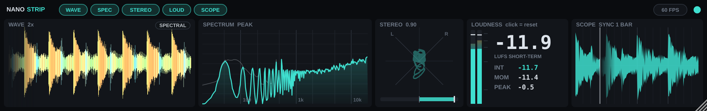
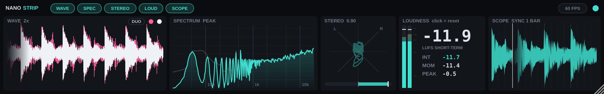

# NanoStrip

A compact, always-readable metering strip for FL Studio (or any DAW). Drop it on a mixer track and it shows whatever passes through. The audio itself is not changed.




| Panel | What it shows | Click it to |
|---|---|---|
| **WAVE** | Scrolling waveform. **SPECTRAL** mode colours it by frequency (orange = lows, green = mids, blue = highs). **DUO** mode uses two colours you pick: outer waveform + inner core | the body: change scroll speed (1x/2x/4x/8x). The SPECTRAL/DUO pill: switch modes. In DUO, the two dots: cycle each colour |
| **SPECTRUM** | Smooth analyzer, 20 Hz to 20 kHz, tilted 4.5 dB/octave so a balanced mix looks flat | toggle the peak-hold line |
| **STEREO** | Goniometer dot cloud plus a correlation bar (green = fine, orange = wide, red = phase problems) | — |
| **LOUDNESS** | Peak/RMS bars, LUFS short-term (big), integrated, momentary, max peak | reset integrated loudness and max peak |
| **SCOPE** | Oscilloscope. Locks to the beat while FL is playing; uses a normal trigger when it is stopped | change the window (1 beat / 2 beats / 1 bar / 2 bars, or 5–40 ms) |

The chips at the top show and hide panels, **60 FPS / 30 FPS** halves CPU use when set to 30, the dot on the right changes the accent colour, and the corner handle resizes the window. Settings are saved with your project. Integrated loudness resets automatically every time playback starts.

Performance: hidden panels do no work, the waveform is drawn from a cached image (only new slices are painted each frame), and the display stops redrawing after 5 seconds of silence.

## Install on a Mac

1. On GitHub, open the **Actions** tab, click the latest green **Build macOS plugin** run, and download **NanoStrip-mac** at the bottom of the page. Unzip it (and unzip `NanoStrip-mac.zip` inside if needed).
2. In Finder press **Cmd+Shift+G** and go to `~/Library/Audio/Plug-Ins/`.
   - Copy `NanoStrip.vst3` into the **VST3** folder.
   - Copy `NanoStrip.component` into the **Components** folder (optional, AU version).
3. The plugin isn't signed with a paid Apple developer ID, so macOS will block it until you clear the download flag. Open **Terminal** and paste:
   ```
   xattr -dr com.apple.quarantine ~/Library/Audio/Plug-Ins/VST3/NanoStrip.vst3 ~/Library/Audio/Plug-Ins/Components/NanoStrip.component
   ```
4. In FL Studio: **Options → Manage plugins → Find plugins**. NanoStrip appears under effects. Add it to a mixer slot, usually on the Master.

`NanoStrip.app` is a standalone version that meters your Mac's audio input.

## Building yourself

Needs Xcode command line tools and CMake:
```
cmake -B build -DCMAKE_BUILD_TYPE=Release
cmake --build build --config Release
```
Built with [JUCE](https://juce.com) 8 (downloaded automatically). JUCE is free for personal use under its own license terms.
